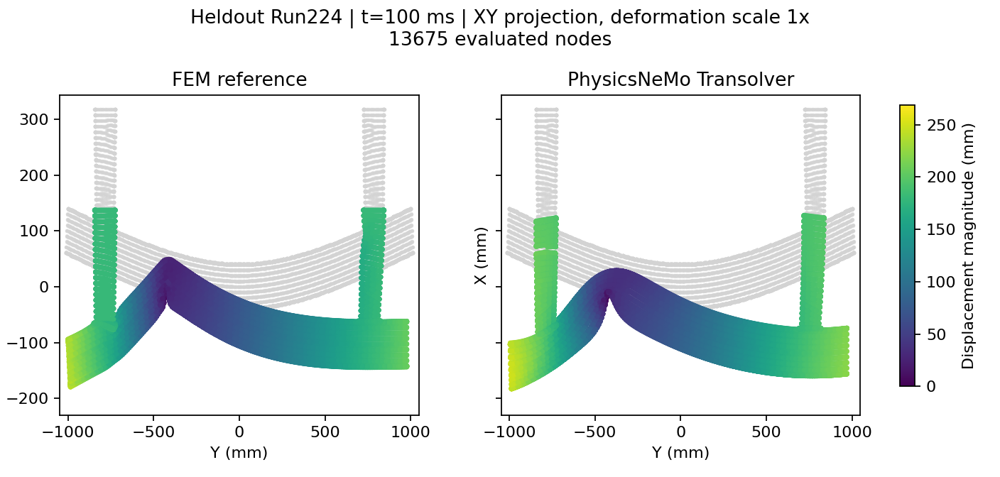

# PhysicsNeMo Impact Lab

NVIDIA PhysicsNeMo 기반 가전제품 낙하·충격해석 AI 연구와 공개 예제 실행 기록.

2026년 10월 15일 공개 범퍼 충돌 데이터로 **PhysicsNeMo 설치·GPU 학습·추론·FEM 대비 오차 검증을 실제 수행**했다. 사용자 PC의 RTX 3060 Laptop 6 GiB에서 전체 변형체 메시 13,675절점, 학습112/내부 검증12/평가7해석의 학습을 완료했다. 별도로 Codex Cloud 환경을 생성해 검사했으나 해당 컨테이너에는 NVIDIA GPU가 노출되지 않았다.

| 실제 실행 | 결과 |
|---|---|
| 전체 메시, 작은 Transolver, 60epoch | 학습260.53초, 평가 변위 상대 L2 **6.12%**, 성분 RMSE **5.16 mm** |
| 동일1,024절점의 작은 Transolver / RBF 회귀 | 변위 상대 L2 **6.38% / 3.14%** |
| 동일1,024절점의 큰 Transolver | 평균 L2 **5.48%**, 최대 국부 벡터 오차112.92mm로 악화 |
| OpenCourant MiniQA 충돌 FEM | starter/engine 정상 종료, 공개 회귀 기준의 표시 정밀도 일치, VTK·에너지 그림 생성 |
| 학습 데이터와 같은 범퍼 Run224 원 FEM 재실행 | 100ms 정상 완주,12분27초, 원 공개 FEM 대비 최종 성분 RMSE **0.0072mm** |
| Codex Cloud 검사 | cgroup CPU4코어 상당·RAM32 GiB, 초기 디스크 여유29.83 GiB, NVIDIA 장치 노출 없음 |

이 결과는 고정된 범퍼 형상·메시에서 두께와 pole 위치를 바꾼 보간 시험이다. 전체 가전제품의 접촉·응력·파손 정확도까지 검증한 결과는 아니다. 작은 신경망 하나로 알고리즘의 우열을 정하지 않는다. 추가 유료 자원이나 결제는 사용하지 않았다.

## 연구 결과 읽기

- [실행 환경·데이터·오차·자원 측정](docs/experiment-results.md)
- [실행 소스·다운로드·학습·추론 재현 명령](outputs/experiment/README.md)
- [저장 예측에서 오차를 다시 계산한 독립 검토](docs/experiment-review.md)
- [전체 제품과 부품의 적용 판단·상용 CAE 확장](docs/research-assessment.md)
- [공식 코드·데이터·논문을 확인한 예제 비교](docs/physicsnemo-source-review.md)
- [FEM 생성과 후처리·알고리즘 대안](docs/fem-integration-review.md)
- [GPU 자원과 비용 근거](docs/resource-options.md)
- [Cloud 실제 검사와 원본 명령 증거](results/cloud/README.md)
- [로컬 GPU 설치와 CUDA 기능 검증](outputs/gpu-experiment/README.md)
- [실제로 실행한 OpenCourant MiniQA와 재현 방법](outputs/fem-experiment/README.md)
- [학습 데이터와 같은 범퍼의 FEM 재실행·절점 대응](outputs/bumper-fem-rerun/README.md)



Run224,100ms,원 좌표+변위·배율1배·XY투영이다. 평가7해석 전체의 평균 수치와 단일 그림을 구분한다.

## 재현과 자료 관리

소스 commit·데이터 revision·파일 해시·분할·seed·실행 로그·체크포인트·수치 결과를 보존한다. 원본 데이터와 타사 solver 실행 파일은 출처에서 별도로 받는다. 공개 deck의 CC BY-NC 조건과 solver AGPL 등은 각 실행 README에 구분해 기록한다. 회사 모델이나 데이터는 포함하지 않는다.

현재 환경을 검사할 때는 다음 명령을 쓸 수 있다. 실행 장소에 맞는 label을 사용하며, 로컬 측정치를 Cloud 사양으로 해석하지 않는다.

```sh
python scripts/probe_environment.py --label codex-cloud --network --output results/cloud/environment.json
```
