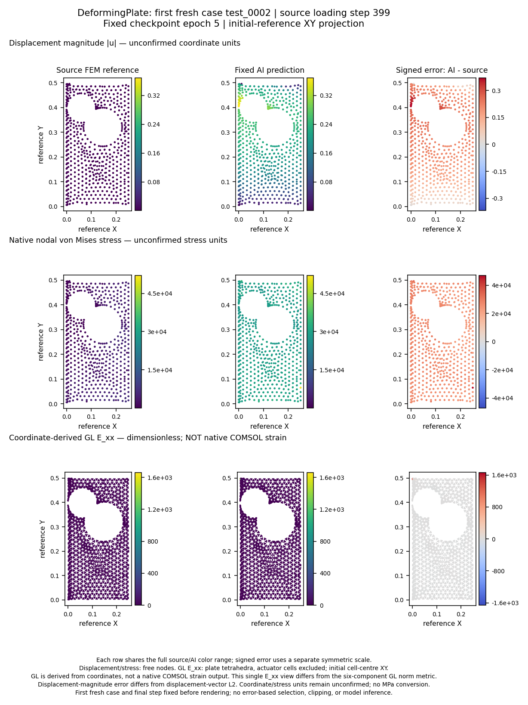

# 실행 결과와 적용 한계

**공개 FEM 입력 실행 → 응력·변형률 확보 → GPU 학습 → 별도 해석 조건 예측 → 오차 검산의 연결은 실제로 작동했다. 현재 신경망을 제품 낙하·충격 FEM의 대체 해석기로 쓸 정확도는 확보하지 못했다.** 변위의 낮은 평균 오차만으로 국부 변형·응력·소성변형·파손을 판단할 수 없다.

이 문서는 2026-10-15 완료 결과를 2026-10-16에 읽기 쉽게 정리한 것이다. 기준 저장소는 `8167c69`이며, 아래 수치는 기존 저장 지표를 옮긴 값이다. 문서 개편으로 새 학습·추론을 수행하지 않았다. [저장소 첫 화면](../README.md) · [전체 실행 근거 부록](../outputs/expanded-research/README.md)

## 먼저 구분할 범위

| 대상 | 형상·조건 변화 | 학습 / 검증 / 평가 | 완료한 신경망 산출물 | 평가 목표 |
|---|---|---|---|---|
| DP600 인장 시편 | 고정 형상·메시, 두 조건축 | 5 / 4 / 4해석 | 정적 6 + 시간 전략 3 | 변위·VM 응력·EPSP·총변형률 주값 |
| 휴대폰 | 고정 형상·메시, 공통 탄성계수 배율·벽 normal Rx | 5 / 2 / 2해석 | 정적 6 | 변위·GPS VM·총변형률 norm·EPSP |
| 범퍼 | 고정 형상·메시, 두께 배율·pole 위치; 속도 일정 | 112 / 12 / 7해석 | 정적 6 | 변위·shell 상하면 VM·EPSP |
| DeformingPlate | 형상·메시·경계조건이 달라지는 공개 궤적 | 최종 확대 실행 32 / 6 / 새 평가 6궤적 | 축소 2 + 공식 크기 1 | 변위·원 nodal VM·좌표 유도 GL 변형률 |

총 **24개는 학습·평가 산출물 수**다. 시편·휴대폰·범퍼의 정적 여섯 설정은 Transolver, FLARE, GeoTransolver GALE, GeoTransolver GALE_FA, MeshGraphNet, FIGConvUNet이다. GALE_FA는 GeoTransolver의 attention 변형이므로 여섯 개의 독립 backbone 계열로 세지 않는다. 판재는 이 여섯 설정의 교차 비교가 아니라 **HybridMeshGraphNet 계열 3설정**이다.

판재에서는 형상·메시가 달라지는 공개 데이터의 별도 궤적을 평가했다. 형상 변화의 영향만 분리하거나 형상 계열별 일반화를 검증한 시험은 아니다. 시편·휴대폰·범퍼의 여섯 설정에 같은 성과를 적용할 수 없다. **동일 형상을 서로 다른 메시로 다시 해석하는 메시 민감도 시험은 수행하지 않았다.** [판재 원 데이터 설명](../outputs/expanded-research/benchmarks/deforming_plate/upstream/README.md#dataset) · [실제 실행 교차표](../outputs/expanded-research/source-matrix/executed-evidence-crosswalk-2026-10-15.md)

## 오차와 물리량을 읽는 방법

상대 L2는 `오차의 norm / 기준장의 norm`이며 아래 표는 %다. 0%가 완전 일치이고, 변위 0을 예측하면 변위 L2는 100%다. 기준 norm이 0인 물리량은 상대 오차를 정의하지 않고 절대 오차를 본다. 서로 다른 문제·물리량의 %를 직접 순위로 묶지 않는다.

| 물리량 | 실제 비교한 값 | 해석 범위 |
|---|---|---|
| 변위 | 초기 좌표를 뺀 xyz 벡터 | 큰 병진이 작은 국부 변형 오차를 가릴 수 있어 평균 병진 제거 오차도 표시 |
| 응력 | 시편·범퍼 shell VM, 휴대폰 GPS nodal VM, 판재 원 nodal VM | 절점 투영·평균값은 원 cell/적분점 hotspot과 다름 |
| 총변형률 | 시편 native tensor의 면내 주값; 휴대폰 native tensor를 투영한 Frobenius norm | solver가 출력한 총변형률에 기반하며 EPSP와 별도 |
| EPSP / 유도 GL | EPSP는 등가소성변형률; 판재 GL은 좌표로 계산한 Green–Lagrange tensor | 판재에는 원 COMSOL strain 출력이 없어 **native strain 검증으로 세지 않음** |

범퍼 전체 131조건의 strain 목표는 EPSP다. Total strain은 별도 Run224 **한 조건**에서 추가 출력·검산했으며 전체 조건의 총변형률 예측 검증이 아니다. [라벨 정의](../outputs/expanded-research/fem-labels/label-semantics.md) · [휴대폰 FEM·데이터 정의](../outputs/expanded-research/benchmarks/drop_test/PHONE-FEM-AND-DATASET.md)

## 휴대폰과 범퍼의 정적 알고리즘 비교

각 문제 안에서는 평가 조건·절점·시점·물리량 정의를 맞췄다. 정규화는 학습 조건, 체크포인트·회귀 설정 선택은 내부 검증 조건만 사용했다. 신경망은 설정당 약 240초의 optimizer 계산 예산을 사용했다. 단일 seed·작은 모델·제한된 예산의 비교이며 수렴이나 알고리즘의 보편적 순위를 입증하지 않는다.

### 휴대폰: 17부품, 출력 corner 76,065절점, 평가 2조건

AI 평가 범위는 **2–20µs의 초기 충격**이다. 전체 변위 기준 norm²의 99.9627%가 평균 병진이므로 병진 제거 오차를 함께 본다. 표의 모든 값은 상대 L2(%)다.

| 방법 | 변위 | 병진 제거 변위 | GPS VM | 총변형률 norm | EPSP |
|---|---:|---:|---:|---:|---:|
| 학습 5조건 평균장 | 0.10736 | 5.55638 | 10.2608 | 6.11538 | 72.0852 |
| POD + RBF | 0.02620 | 1.356 | 2.61635 | 2.11085 | 30.9711 |
| POD + ridge | 0.02847 | 1.474 | 2.24952 | 2.13582 | 25.0761 |
| Transolver | 1.30285 | 67.4430 | 33.8000 | 36.4939 | 96.0813 |
| FLARE | 1.78040 | 86.4631 | 55.1959 | 57.7764 | 99.3542 |
| GeoTransolver GALE | 1.44160 | 74.0676 | 32.0092 | 35.1488 | 96.9469 |
| GeoTransolver GALE_FA | 2.82385 | 145.484 | 60.6539 | 67.7150 | 99.9753 |
| MeshGraphNet | 1.45528 | 67.1408 | 36.7686 | 34.2545 | 97.1175 |
| FIGConvUNet | 2.46113 | 127.046 | 53.0842 | 63.1644 | 99.5273 |

**이번 조건에서는 학습 평균장도 여섯 신경망보다 위 집계 오차가 낮았다.** POD + RBF는 학습 응답의 전체 중심화 mode를 써서 직접 RBF와 수치적으로 거의 같으므로 별도 우승 알고리즘으로 중복 계산하지 않는다. EPSP 참값은 1,521,300개 절점×시점 중 27개만 양수이며, 한 평가 조건은 모두 0이다. 작은 절대량과 희소한 소성 영역을 함께 읽어야 한다.

원 예측의 음수 응력·음수 strain norm·음수 EPSP와 EPSP 이력 감소도 기록했다. 예를 들어 Transolver의 음수 EPSP는 658,778개다. 평균 오차와 별개로 물리적 출력 제약을 통과하지 못했다. [신경망 원 지표·시간·자원](../outputs/expanded-research/benchmarks/drop_test/models-full-c6/SUMMARY.md) · [회귀·축약 원 지표](../outputs/expanded-research/benchmarks/rom/phone9-full/metrics.json) · [평균장 원 지표](../outputs/expanded-research/full-support-mean-baselines.md)

별도 중심 조건 FEM은 **0.5ms까지 정상 완료**했다. 이는 20µs AI 모델을 0.5ms까지 학습·예측한 결과가 아니다. 전체 반발 완료도 확인되지 않았다. [0.5ms FEM과 검산](../outputs/expanded-research/benchmarks/drop_test/500us-final-review.md)

### 범퍼: 전체 변형체 13,675절점, 평가 7조건

10–100ms의 10개 비영 시점을 평가했다. 상 / 하는 shell upper / lower 면을 뜻한다. 모든 오차는 상대 L2(%)다.

| 방법 | 변위 | VM 응력 상 / 하 | EPSP 상 / 하 |
|---|---:|---:|---:|
| 학습 112조건 평균장 | 20.5503 | 41.4694 / 41.4290 | 83.8202 / 84.6501 |
| POD + RBF | 3.0320 | 15.059 / 15.572 | 51.849 / 55.022 |
| Transolver | 6.3208 | 26.0753 / 25.9900 | 42.9540 / 43.2482 |
| FLARE | 7.1697 | 29.2712 / 28.8180 | 61.8180 / 62.8264 |
| GeoTransolver GALE | 6.0032 | 24.5831 / 24.4616 | 44.5157 / 44.8914 |
| GeoTransolver GALE_FA | 6.9870 | 28.2367 / 27.7442 | 58.0797 / 59.2232 |
| MeshGraphNet | 6.3904 | 26.6175 / 26.3121 | 56.5572 / 58.3442 |
| FIGConvUNet | 8.3375 | 25.7672 / 26.0460 | 47.8592 / 48.5323 |

POD + RBF는 변위·응력에 유리했지만, Transolver는 EPSP에서 더 낮은 오차를 보였다. **한 방법이 모든 물리량에서 가장 좋지는 않았다.** Transolver의 VM RMSE는 상 / 하 75.073 / 75.442MPa이며, 원 예측의 EPSP 음수는 201,590 / 205,166개다. 변위를 맞추는 성능이 소성변형·파손 위험 정확도를 보장하지 않는다. [신경망 원 지표·시간·자원](../outputs/expanded-research/benchmarks/bumper/models-c7/SUMMARY.md) · [POD + RBF 원 지표](../outputs/expanded-research/benchmarks/rom/bumper7/metrics.json)

[휴대폰·범퍼 비교 그림 크게 보기](../outputs/expanded-research/revisions/v2/full-support-algorithm-comparison.png). 각 열의 로그 축·단위가 다르고 범퍼 응력의 상하면을 따로 표시한다. 저장 예측의 [독립 검산](../outputs/expanded-research/full-support-latest-audit.md)은 지표 일치를 확인한 것이며 제품 정확도 승인이 아니다.

## 인장 시편: 작은 고정 형상에서의 비교

13개 해석 중 4개 평가 조건, 919개 학습 절점·10시점의 결과다. 모든 오차는 상대 L2(%)이며 마지막 열은 총변형률의 면내 major / minor 주값이다.

| 방법 | 변위 | VM 응력 | EPSP | 총변형률 major / minor |
|---|---:|---:|---:|---:|
| POD + quadratic ridge | 0.10381 | 0.13648 | 0.40997 | 0.38762 / 0.38841 |
| Transolver | 1.91108 | 5.49081 | 2.09416 | 2.05924 / 2.48257 |
| FLARE | 1.98289 | 6.47775 | 2.40148 | 2.28893 / 2.68276 |
| GeoTransolver GALE | 2.05914 | 3.59524 | 2.56986 | 2.46994 / 2.70034 |
| GeoTransolver GALE_FA | 1.76022 | 3.89231 | 2.42083 | 2.39051 / 2.62752 |
| MeshGraphNet | 6.94849 | 23.7175 | 24.9543 | 24.1273 / 24.2624 |
| FIGConvUNet | 3.00770 | 1.79232 | 2.97786 | 2.80558 / 2.94235 |

POD는 내부 검증으로 rank 2를 골랐으며 학습의 중심화 응답 분산 99.99374%를 설명했다. 두 조건축·고정 형상의 저차원 응답에 유리한 결과이며 새 제품·접촉·파손 일반화의 근거는 아니다. FIGConvUNet은 이번 신경망에서 응력 오차가 가장 낮았지만 음수 EPSP·시간 감소·주값 순서 위반이 남았다. [원 비교표](../outputs/expanded-research/benchmarks/structural_coupon/static-six-model-comparison.json) · [회귀·축약 원 지표](../outputs/expanded-research/benchmarks/rom/coupon13/metrics.json) · [비교 그림](../outputs/expanded-research/coupon-algorithm-comparison.png)

시각 조건부·자기회귀·teacher forcing의 시간 전략 3개도 별도 학습했다. 시각 조건부는 일부 물리량에서 평균장보다 낮은 오차를 보였지만 응력·작은 횡변위·평면성에 과제가 남았다. 자기회귀와 teacher forcing의 자유 예측은 평균장보다 나빴다. 이를 휴대폰·범퍼 시간 전개 학습 완료로 세지 않는다. [시간 전략 실행 결과](../outputs/expanded-research/benchmarks/temporal_strategies/execution-summary.json)

## DeformingPlate: 형상 변화를 포함한 시험의 실패

공개 데이터는 형상·경계조건이 다르며 각 궤적에 고유 메시가 있다. 실제 학습한 모델은 HybridMeshGraphNet의 축소 2설정과 공식 크기 1설정이다. 위의 여섯 정적 설정 전체를 형상 변화로 비교한 결과는 아니다. 변위·응력은 399단계 자유 예측으로 평가했다.

| 설정 | 평가 범위 | 변위 L2 | 원 nodal VM L2 | 판단 |
|---|---|---:|---:|---|
| 축소 모델, noise 0.003 | 개발 2궤적 | 175.303% | 75.624% | 정확도 실패, 예측 요소 역전 발생 |
| 축소 모델, noise 0 + 정규화 변경 | 개발 2궤적 | 98.419% | 73.415% | 탐색적 비교, 정확도 기준 미달 |
| 공식 크기 hidden128 / 15 blocks | 새 최종 6궤적 | **241.217%** | **68.236%** | **예측 역전 4/6조건, 정확도·기하학 안정성 실패** |

최종 모델은 32학습 궤적×8시점×5epoch, 1,280업데이트로 학습했다. 변위는 영변위 기준 100%보다 나빴다. 원 평가 6궤적에는 역전이 없었고 예측에서는 4조건에 발생했다. 원 COMSOL strain은 없으며 21표본시점의 좌표로 구한 GL tensor 상대 L2는 **1,293.454배**였다. 이는 % 표시가 아니며 native strain 검증도 아니다. 원 응력·좌표의 물리 단위는 미확정이므로 MPa·mm로 환산하지 않는다.

이 결과는 공식 architecture를 제한된 데이터·학습 예산으로 실행한 것이며 NVIDIA의 8 H100 학습이나 원논문의 수렴 결과 재현은 아니다. [축소 2설정 기록](../outputs/expanded-research/benchmarks/deforming_plate/README.md) · [공식 크기 최종 평가](../outputs/expanded-research/benchmarks/deforming_plate/official32_fresh_final_corrected/README.md) · [원 배열의 독립 297검사](../outputs/expanded-research/benchmarks/deforming_plate/review/official32-streaming-numeric-audit-v1.md)

이 그림은 최종 6조건 중 사전에 고정한 test0002의 마지막 단계만 보여 준다. 초기 좌표의 XY 투영이며 전체 조건 집계의 대체 자료로 읽지 않는다.

## 시간·자원·비용

실행 장소는 로컬 RTX 3060 Laptop 6GiB다. 별도 검사한 Codex Cloud 컨테이너에는 NVIDIA GPU가 노출되지 않았다. 추가 유료 GPU 지출은 **0**이며 전기·기존 장비·구독 비용을 측정한 값은 아니다.

| 실제 실행 | 시간 | 읽는 기준 |
|---|---:|---|
| 휴대폰·범퍼 정적 12설정 optimizer 합계 / training wall 합계 | 48.048분 / **128.235분** | 읽기·검증·관측 등이 wall에 포함됨 |
| 같은 12설정·평가 54조건 GPU forward 합계 / test process wall 합계 | 6.853초 / 429.456초 | 6.853초를 연구 전체 시간이나 FEM 대체 속도로 해석하지 않음 |
| 공식 크기 판재 train + validation / 별도 프로세스 최종 6조건 | 2,319.975초 / 291.370초 | 학습 측 Torch 최대 할당 약 2.97GiB, OS peak RSS 약 1.61GiB |

휴대폰 MeshGraphNet B5는 CUDA OOM, FIGConvUNet B5는 host RAM 부족으로 중단했다. 성공한 B1 / B2로 본학습을 완료했다. 별도 휴대폰·범퍼 시간 전개 6설정은 **본학습 완료 0**이며 자원 검사에서 중단한 기록이 있다. 이 부족·미완료를 완료 24개에 섞지 않는다. [배치 시험과 실패](../outputs/expanded-research/benchmarks/batching/README.md) · [시간 전개 자원 검사](../outputs/expanded-research/benchmarks/temporal_strategies/resource-calibration-v1/SUMMARY.json)

## 다음 복잡 형상 시험과 근거 찾기

새 캠페인의 [문제 구성과 실행 전 설정](../outputs/expanded-research/geometry-next/README.md)을 준비했다. 같은 충돌·재료 조건에서 초기 차량 형상만 바꾸어 변위·VM 응력·EPSP를 예측하는 문제다. 5계열·6설정 및 조건부 회귀·축약 기준선, 형상별 데이터 분할, 입력 해상도와 FEM 재메시 시험을 구분했다. 표준 라이브러리 설정 검사 도구까지 준비했으며 **접근 승인·실제 필드 확인·형상별 로더·새 학습은 아직 남아 있다.** 현재 고정 형상 결과나 판재 한 계열의 시험을 모든 알고리즘의 복잡 형상 검증으로 취급하지 않는다.

- [전체 실험 근거 부록](../outputs/expanded-research/README.md): 저장 지표, 실패, 그림, 자원, 검산의 상세 기록.
- [공식 소스와 실행 증거 교차표](../outputs/expanded-research/source-matrix/executed-evidence-crosswalk-2026-10-15.md): 소스 확인·설치·기능 검사·학습·평가 구분.
- [초기 변위 전용 연구](experiment-results.md): 전체 메시 Transolver 변위 L2 **6.12%**. [이전 변형 비교 그림](../outputs/experiment/fulltraining/deformed_geometry_comparison.png)도 이 단계의 그림이며 후속 응력·변형률 학습 그림이 아니다.
- [수치 Q1 FEM·DDM 실행](../outputs/expanded-research/benchmarks/elasticity_numerical/full-ddm/attempt02/README.md): 신경망 학습 결과로 세지 않음.
- [개편 전 README 원문](archive/README-before-20261016.md): 기존 안내와 상세 링크를 그대로 보존.

공식 예제 소스 pin은 `11685edb3ec1fb6f25665e96cf7a8c4d11a23f16`, 실제 학습 backbone은 PhysicsNeMo 2.2.2다. 공식 저자 결과와 이 저장소에서 실제 실행·측정한 결과를 구분한다. 원 데이터·체크포인트·예측 배열의 공개 가능 범위와 재현용 소스·설정·로그·지표의 제공 범위도 각 실행 문서에 기록했다.
