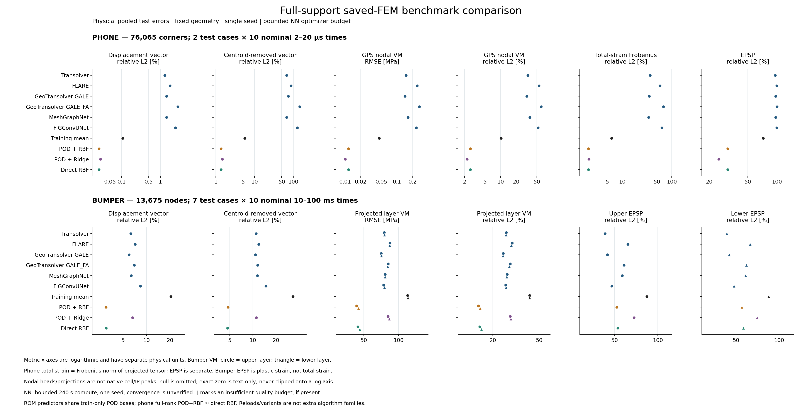
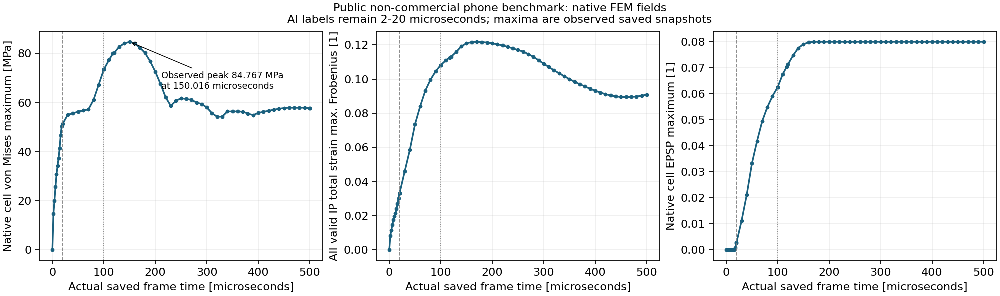

# 구조해석 다중 물리량 실행 검증

2026-10-15에 실제 생성·학습·추론한 증거를 모은 후속 연구 기록이다. **구조역학만** 다루며 유체 예제는 포함하지 않는다. 진행 중인 실험을 완료로 세지 않는다. 아래 수치의 원본은 개별 실행의 JSON·로그·독립 검산이다.

## 실제 정답 확보

| 구조 예제 | 실제 정답과 규모 | 응력·변형률의 의미 |
|---|---|---|
| 공개 범퍼 충돌 | 131해석, 1,441 ANIM 원본, 전체 변형체 13,675절점. 원본11시점(0포함), 모델 평가10개 비영 시점. 학습112/내부 검증12/평가7 | shell local 응력에서 계산한 upper/lower 면내 VM, upper/lower 등가소성변형률(EPSP). 면적 투영 nodal scalar와 원 cell tensor·상태를 별도 보존 |
| OpenCourant DP600 인장 시편 | 직접 생성한 13해석, shell808개·학습 절점919개·10시점. 학습5/검증4/평가4 | native VM, EPSP, native total-strain tensor의 면내 주값 major/minor. 총변형률을 변위 미분으로 대체하지 않음 |
| OpenCourant 휴대폰 초기 충격 | 실제 9조건·전체 출력 corner76,065절점·17부품, 학습5/검증2/평가2. 별도 중심 조건0.5ms도 정상 완주 | native solid stress·total strain·EPSP 및 GPS nodal stress. AI9조건은20µs까지이며 중심 FEM0.5ms의 전체 반발 완료는 확인되지 않음 |
| 공개 DeformingPlate | 실제 400시점 궤적 다운로드·학습·자기회귀 실행 | 원본 nodal scalar `stress`는 원논문이 von Mises로 정의(물리 단위 미확정). 원 COMSOL strain 출력은 없으며, 좌표에서 계산한 Green–Lagrange strain은 별도 유도 기준값 |
| 공식 Q1 선형 탄성·수치 DDM | CPU 단일 영역 solve와 전체32×32 문제의2×2영역 분할 solve를 실제 실행. DDM64반복 수렴·독립25검사 통과 | Q1 FEM의 변위·미소변형률·평면응력·VM을 비교한 수치 기준선. 신경망 학습이나 낙하·접촉·소성 정확도 검증으로 세지 않음 |
| OpenCourant BOX1BL 충돌 회귀시험 | 앞선 단계에서 공개 MiniQA Starter·Engine 실제 실행 | 작은 구조 충돌 solver 실행 확인. 이번 다물리량 surrogate fit을 추가로 완료한 사례로 세지 않음 |

공개 curated 범퍼의 변위만으로 응력 학습이 됐다고 주장하지 않았다. RAW ANIM 3.799GB를 추가 확보하고, hash·형상·ID·실제 시점·물리량·112/12/7 분할을 검증한 2.921GB 라벨 캐시를 동결했다. 전체 cache 작성자의 전수 hash 검증과 독립 검토자의 메타데이터 전수·원 binary 표본 검산은 별개다. [범퍼 정답 추출](fem-labels/README.md), [시편 정답 생성](benchmarks/structural_coupon/README.md)

범퍼 Run224는 total-strain 출력 카드를 추가하여 OpenCourant FEM을 실제 재실행했다. Starter 10.72초 + Engine 502.69초이며, 출력 추가 전후 11시점의 변위·응력·EPSP 차이는 0이었다. 이 total-strain 정답은 **한 조건**이며 131조건의 total-strain 일반화 데이터로 취급하지 않는다.

## 확인된 예측 결과

인장 시편에서 세 회귀/축약 모델과 PhysicsNeMo 여섯 설정이 실제 fit·학습·별도 평가·체크포인트 재추론을 마쳤다. 여섯 설정은 다섯 backbone 계열이며, GeoFLARE는 GeoTransolver의 `GALE_FA` attention 변형이다. 단위·절점·시간·분할·train-only 통계를 맞춘 결과이며, 전부 고정 형상과 두 가지 조건 변수의 보간 시험이다.

| 시편, 평가4조건 | 변위 벡터 상대 L2 | VM 응력 상대 L2 / RMSE | EPSP 상대 L2 | 총변형률 주값 major / minor 상대 L2 |
|---|---:|---:|---:|---:|
| POD + quadratic ridge | 0.10381% | 0.13648% / 0.70462MPa | 0.40997% | 0.38762% / 0.38841% |
| Transolver, 1,000epoch | 1.91108% | 5.49081% / 28.3485MPa | 2.09416% | 2.05924% / 2.48257% |
| FLARE, 1,000epoch | 1.98289% | 6.47775% / 33.4440MPa | 2.40148% | 2.28893% / 2.68276% |
| GeoTransolver GALE, 1,000epoch | 2.05914% | 3.59524% / 18.5619MPa | 2.56986% | 2.46994% / 2.70034% |
| GeoTransolver GALE_FA, 1,000epoch | 1.76022% | 3.89231% / 20.0956MPa | 2.42083% | 2.39051% / 2.62752% |
| MeshGraphNet, 325epoch / best225 | 6.94849% | 23.7175% / 122.4514MPa | 24.9543% | 24.1273% / 24.2624% |
| FIGConvUNet, 465epoch / best365 | 3.00770% | 1.79232% / 9.2536MPa | 2.97786% | 2.80558% / 2.94235% |

최소100epoch·검증 patience100·최대1,000epoch을 공통으로 적용했고, MGN과 FIG는 내부 검증 정체로 조기 종료했다. 나머지 설정은 예산 상한 또는 그 근처가 최선이므로 수렴을 입증하지 못했다. 단일 seed·작은 개별 구조·서로 다른 파라미터 수의 결과이며 알고리즘의 보편적 우열이 아니다. 여섯 설정의 학습 시간은77.08–375.78초였다. 새 프로세스 재추론은 다섯 설정에서 차이0, MGN에서 최대0.000183105MPa(정규화 차이1.614e-6, 사전 허용치1e-5 이내)였다. [원 비교표·실행 hash](benchmarks/structural_coupon/static-six-model-comparison.json)

POD는 내부 검증으로 rank2를 골랐으며 training의 중심화 응답 분산 99.99374%를 설명했다. 형상이 고정되고 조건이 두 개뿐인 응답은 저차원 회귀에 유리하다. 이 낮은 오차를 임의의 가전제품·새 메시·접촉·파손 일반화로 해석하지 않는다. [회귀/축약 실행](benchmarks/rom/coupon13/metrics.json)

Transolver는 최선 epoch가 예산 상한 1,000과 같아 수렴을 입증하지 못했다. 변위 전체 L2는 1.91%지만 작은 횡변위 y의 상대 오차는 55.17%였다. 원래 평면 문제의 u_z는 약 1e-13mm인데 예측 z RMSE는 0.002512mm였다. 예측 응력 36,760개 중 3,417개가 음수(최소 -57.88MPa), EPSP는 6,753개가 음수였다. 전역 평균 오차만으로 물리적으로 타당한 모델이라고 판정하지 않는다. POD의 EPSP 음수는 약 1e-9 수준이며 크기를 함께 구분한다. 원 예측을 clipping하지 않았다.

FIG는 이번 신경망 중 응력 오차가 가장 작았지만 EPSP 음수6,787개, 시간에 따른 EPSP 감소7,962개, major/minor 순서 위반2,477개가 있었다. 면외 z 오차도 RMSE0.01543mm·최대0.09070mm였다. 응력 평균 오차가 작다는 사실만으로 물리 제약까지 통과했다고 판정하지 않는다. [물리량별 FEM/예측/오차 그림](benchmarks/structural_coupon/models/figconvunet/)

범퍼의 다중 물리량 POD+RBF도 실제 학습·내부 검증 선택·평가를 마쳤다. 변위 L2는 3.0320%지만 VM upper/lower L2는 15.059%/15.572%(RMSE 43.357/45.201MPa), EPSP는 51.849%/55.022%였다. EPSP 예측의 약 22%가 음수였다. **변위가 잘 맞는다는 이유로 소성변형·파손 위험도 맞는다고 판단할 수 없다.** 이 사례의 strain은 EPSP이며 total strain과 다르다.

동일한 범퍼 전체 support·112/12/7 분할에서 여섯 신경망 모두 실제 학습·새 프로세스 재로딩 검사·test7조건 한 번·독립 수치 검산을 마쳤다. MGN의 재로딩 정규화 차이는1.90735e-6으로 사전 허용치1e-5 이내이고 나머지 다섯 설정은0이었다.

| 범퍼, 평가7조건 | 변위 벡터 L2 | 병진 제거 형상 변위 L2 | VM upper / lower L2 | VM upper / lower RMSE | EPSP upper / lower L2 |
|---|---:|---:|---:|---:|---:|
| 학습112조건의 node/time별 평균장 | 20.5503% | 33.3162% | 41.4694% / 41.4290% | 119.393 / 120.258MPa | 83.8202% / 84.6501% |
| POD + RBF | 3.0320% | 4.74479% | 15.059% / 15.572% | 43.357 / 45.201MPa | 51.849% / 55.022% |
| Transolver B5, 240초 optimizer 예산 | 6.3208% | 10.9944% | 26.0753% / 25.9900% | 75.073 / 75.442MPa | 42.9540% / 43.2482% |
| FLARE B5, 같은 계산 예산 | 7.1697% | 11.8860% | 29.2712% / 28.8180% | 84.274 / 83.652MPa | 61.8180% / 62.8264% |
| GeoTransolver GALE B5, 같은 계산 예산 | 6.0032% | 10.8372% | 24.5831% / 24.4616% | 70.777 / 71.006MPa | 44.5157% / 44.8914% |
| GeoTransolver GALE_FA B5, 같은 계산 예산 | 6.9870% | 11.5670% | 28.2367% / 27.7442% | 81.296 / 80.535MPa | 58.0797% / 59.2232% |
| MeshGraphNet B2, 같은 계산 예산 | 6.3904% | 11.4514% | 26.6175% / 26.3121% | 76.634 / 76.377MPa | 56.5572% / 58.3442% |
| FIGConvUNet B5, 같은 계산 예산 | 8.3375% | 14.8218% | 25.7672% / 26.0460% | 74.186 / 75.605MPa | 47.8592% / 48.5323% |

이 Transolver는 실제4,120업데이트·20,063조건 관측·179완료 epoch 중 best149를 선택했다. 마지막 부분 epoch의3업데이트·15관측은 선택에서 제외했다. Optimizer240.037초와 training wall901.421초를 구분한다. POD+RBF가 변위·응력에 유리했으나 이번 신경망이 EPSP에는 더 낮은 오차를 보였으므로 한 방법이 모든 물리량에서 낫다고 결론내리지 않는다. VM 원 단위는 GPa이며 위 RMSE는 ×1000한 MPa다. Raw 음수 VM upper/lower4,239/5,942개, 음수 EPSP201,590/205,166개와 EPSP 이력 감소258,776/263,206개도 남아 있다. [첫 범퍼 신경망 원 지표](benchmarks/bumper/models-c7/transolver/test_report.json), [평균장 기준선](full-support-mean-baselines.md)

FLARE는 실제1,488업데이트·7,248관측·64완료 epoch 중 best58을 선택했고 부분 epoch16업데이트는 제외했다. Optimizer240.002초·training wall537.195초였으며 EPSP 음수479,915/488,649개·이력 감소358,977/354,601개를 기록했다. 두 신경망은 평균장보다 집계 오차가 낮지만 원 물리 제약 위반과 단일 seed·예산 제한을 함께 보고한다. [FLARE 원 지표](benchmarks/bumper/models-c7/flare/test_report.json)

GeoTransolver GALE는 실제3,579업데이트·17,430관측·155완료 epoch 중 best153을 선택했고 부분 epoch14업데이트는 제외했다. Optimizer240.009초·training wall787.704초였다. EPSP 음수274,291/250,132개·이력 감소378,649/390,680개도 남아 있다. 수치 감사 통과는 저장 지표의 일치이며 제품 적용 정확도 승인을 뜻하지 않는다. [GALE 원 지표](benchmarks/bumper/models-c7/geotransolver/test_report.json)

GALE_FA는1,237업데이트·6,026관측·53완료 epoch 중 best48이며 부분 epoch18업데이트는 제외했다. Optimizer240.108초·training wall471.925초, EPSP 음수328,149/334,074개·이력 감소345,633/354,332개였다. [GALE_FA 원 지표](benchmarks/bumper/models-c7/geoflare/test_report.json)

MGN은3,387업데이트·6,774관측·60완료 epoch 중 best48이며 부분 epoch27업데이트는 제외했다. Optimizer240.058초·training wall495.465초였다. FIG는680업데이트·3,313관측·29완료 epoch 중 best29(667업데이트·3,248관측)를 선택했고 부분 epoch13업데이트는 제외했다. Optimizer240.261초·training wall397.828초이며 마지막 검증도 개선 중이라 수렴은 미확인이다. MGN/FIG의 EPSP 음수 upper/lower는 각각429,689/407,520개와392,711/371,146개다. [전체 범퍼 설정·노출·메모리·시간 비교](benchmarks/bumper/models-c7/SUMMARY.md)

각 열은 별도 로그 축이며 변위 벡터·병진 제거·MPa 응력 RMSE·응력/변형률 L2를 구분한다. 그림의 fixed geometry는 공통 reference mesh 좌표를 뜻한다. 범퍼는 두께 배율·벽 y위치가 변하고 속도는 전부−5mm/ms이며, 휴대폰은 공통 E배율·벽 normal의 Rx가 변한다. 제품 NODE를 회전하거나 새 형상을 생성한 데이터가 아니다. Upper/lower와 native cell/IP hotspot도 구분해 읽는다. 최초 렌더의 빠진 숫자 눈금은 원본을 보존하고 plot source의 눈금만 수정했으며 총2회 렌더·모델 호출0회였다. [수치·입력 hash·시각 QA](revisions/v2/full-support-algorithm-comparison.json)

DeformingPlate의 공식 HybridMeshGraphNet 축소 구조를 두 설정으로 실제 학습했다. 각각 12epoch·1,920업데이트이며 399단계 자기회귀를 평가했다. noise 제거와 loss 정규화 변경을 묶은 설정은 drift를 줄였지만 내부 검증 응력을 악화했고, 두 설정 모두 정확도 실패였다. 원 COMSOL strain이 없는 이 예제의 유도 strain 비교를 native FEM strain 검증이라고 부르지 않는다. [판 실행 기록](benchmarks/deforming_plate/README.md)

판 loader만으로 stress invariant를 확정할 수는 없었으나, [원논문 Section4의 DeformingPlate 설명](https://ar5iv.labs.arxiv.org/html/2010.03409#S4)과 [저자 프로젝트](https://sites.google.com/view/meshgraphnets/home)가 nodal von Mises stress로 정의함을 추가 확인했다. 이 근거가 물리 단위까지 확정하는 것은 아니므로 MPa로 임의 환산하지 않는다.

## 휴대폰 전체 조립체의 실제 예측과 범위

공개 deck으로 새로 생성한 OpenCourant9조건의 전체 출력 corner76,065절점에서 POD+RBF, POD+ridge, 직접 RBF를 실제 fit·내부 검증 선택·평가·새 프로세스 재추론했다. 원257,099절점 중181,034개 TETRA10 midside는 이 출력 support에서 제외한다. 17부품의 실제 solid 인접 graph는561,184방향간선·17연결 성분이다. FEM의14개 tied/contact 및 wall을 가로지르는 간선을 학습 graph에 추가한 것은 아니다. [FEM·데이터 정의](benchmarks/drop_test/PHONE-FEM-AND-DATASET.md), [전체 예측](benchmarks/rom/phone9-full/metrics.json)

| 전체 corner, 평가2조건 | 변위 L2 | 병진 제거 형상 변위 L2 | GPS 응력 VM L2 | 총변형률 Frobenius L2 | EPSP L2 |
|---|---:|---:|---:|---:|---:|
| POD + RBF | 0.02620% | 1.356% | 2.61635% | 2.11085% | 30.9711% |
| POD + ridge | 0.02847% | 1.474% | 2.24952% | 2.13582% | 25.0761% |
| 학습5조건의 node/time별 평균장 | 0.10736% | 5.55638% | 10.2608% | 6.11538% | 72.0852% |
| Transolver B5, 240초 optimizer 예산 | 1.30285% | 67.4430% | 33.8000% | 36.4939% | 96.0813% |
| FLARE B5, 같은 계산 예산 | 1.78040% | 86.4631% | 55.1959% | 57.7764% | 99.3542% |
| GeoTransolver GALE B5, 같은 계산 예산 | 1.44160% | 74.0676% | 32.0092% | 35.1488% | 96.9469% |
| GeoTransolver GALE_FA B5, 같은 계산 예산 | 2.82385% | 145.484% | 60.6539% | 67.7150% | 99.9753% |
| MeshGraphNet B1, 같은 계산 예산 | 1.45528% | 67.1408% | 36.7686% | 34.2545% | 97.1175% |
| FIGConvUNet B2, 같은 계산 예산 | 2.46113% | 127.046% | 53.0842% | 63.1644% | 99.5273% |

전체 메시의 첫 신경망 Transolver는 실제795epoch/795Adam업데이트/3,975조건 관측을 마쳤고 best754epoch를 내부 검증으로 선택했다. 새 프로세스 validation 재추론 차이0 후 test2조건을 한 번 예측하고, 별도 수치 검산에서 원 FEM·예측·RMSE/L2/P95/max·checkpoint 선택을 확인했다. VM RMSE0.150670MPa, total-strain Frobenius RMSE7.96288e-5, EPSP RMSE3.31994e-6였다. 원 예측의 음수 VM600,081개·Frobenius520,256개·EPSP658,778개, EPSP 시간 감소593,109/1,369,170개를 보존했다. EPSP 참값은 전체1,521,300점×시점 중27개만 양수다. 엄밀0 기준 support 통계와 감소량을 물리적 파손 허용치로 해석하지 않는다. 원 예측 배열은 로컬에 보존한다. [최종 지표·실행 hash·그림](benchmarks/drop_test/models-full-c6/transolver/), [독립 검산](full-support-evaluation-review.md)

이 첫 실행의240.244초는 optimizer 구간이며 총 wall은923.502초였다. data read/정규화238.807초, H2D21.025초, CPU상태/체크포인트2.415초, validation4.763초, Windows 전체 프로세스 관측372.581초 등을 기록했다. 일부 타이머 경계가 겹치므로 이를 전부 더해 wall의 완전한 분할로 취급하지 않는다. 관측 비용만 총 wall의 약40.3%이므로 이를 순수 모델 계산 시간으로 보고하지 않는다. 휴대폰·범퍼12설정은 같은 실행 소스·240초 규약으로 학습·평가를 마쳤다.

FLARE와 GeoTransolver GALE도 실제 학습·새 프로세스 검증 재추론 차이0·test 한 번·원 FEM 기준 독립 수치 검산을 마쳤다. 각각247/682업데이트·1,235/3,410조건 관측이며, 최선 체크포인트가 마지막 완료 epoch247/682다. 두 설정은 마지막 validation도 개선 중이므로 수렴을 입증하지 못했다. VM RMSE는 각각0.246047/0.142688MPa다. 이번 제한된 계산 예산의 결과를 알고리즘의 일반적 우열로 확대하지 않는다.

GALE_FA도208업데이트·1,040조건 관측·별도 예측·독립 검산을 마쳤지만, 이번 예산에서는 병진 제거 형상 오차가100%보다 컸다. 변위 제곱오차는 초기속도와 중력만으로 계산한 기준선의2.129배였다. 마지막 update까지 마쳐241.127초로 상한을1.127초 넘겼으며 이 차이를 숨기지 않았다. 이 설정 역시 마지막 검증이 최선이라 수렴이나 알고리즘의 보편적 우열을 확정하지 않는다.

MGN은764업데이트·764조건 관측 중152완료 epoch, FIG는403업데이트·672관측 중134완료 epoch였다. 마지막 부분 epoch의 각각4업데이트/1업데이트는 checkpoint 후보에서 제외했고 best150/133을 선택했다. 새 프로세스 검증 차이는 MGN의 scale-normalized 최대5.72205e-6(사전 허용치1e-5 이내), 나머지 다섯 설정은0이었다. 독립 수치 감사는 여섯 모델 모두 원 FEM·물리 지표·checkpoint/학습량·한 번의 test와 일치했으며, 이를 제품 정확도 승인으로 부르지 않는다.

같은 평가 정답에서 **학습5조건의 node/time별 산술 평균장도 현재 여섯 신경망보다 위 집계 지표가 낮았다.** 평균장은 조건 입력을 무시하는 고정 형상 기준선이다. Train5 평균→float32가 저장 mean field와 bitwise 일치함을 확인하고 기존 test truth로만 별도 산출했으며 새 신경망 추론·선택·추가 fit은 하지 않았다. EPSP 음수와 시간 감소는0이었지만 EPSP 오차72.09%로 소성부를 잘 맞추지는 못했다. 이 결과는 현재의 데이터 수·작은 모델·짧은 계산 예산에서 신경망의 유용한 향상을 확보하지 못했다는 뜻이다. [평균장 산출·자체 검산](full-support-mean-baselines.md)

여섯 신경망 모두 저장된 예측으로 두 test조건의 EPSP 확대 그림을 추가 생성했다. ROI는 정답의 전 시점 양수 support와1mm 여유로 고정한89절점이며 예측 오차를 보고 영역을 고르지 않았다. 첫 조건의 최종 정답은 모두0, 두 번째는11절점이 양수다. 첫 조건 그림만으로 소성부 예측을 판단하지 않도록 두 조건을 함께 표시했다. 이 후처리는 추가 모델 추론·학습이 아니다. [두 조건 FEM/예측/오차 확대](phone-visual-comparison/transolver/epsp_both_tests_truth_support_zoom.png)

POD rank4는 학습5조건의 양수 중심화 mode4개 전부를 사용하므로 full POD+RBF와 직접 RBF 결과는 수치적으로 거의 같다. 이를 별개의 성능 우위로 세지 않는다. 변위 기준 norm²의99.9627%가 평균 병진이며, 작은 전체 변위 L2로 국부 변형을 대신 평가하지 않는다. 평가2조건 EPSP는 총1,521,300개 절점×시점 중27개만 비영이고 첫 조건의 정답 EPSP는 전부0이다. 정답 norm0인 조건의 EPSP 상대 오차는 undefined로 두고 절대 오차·비영 support를 따로 기록했다. 세 predictor는 새 프로세스 재추론 차이0을 확인했다.

학습 GPS_VM은 원6성분 nodal GPS 응력에서 계산한 scalar이며 native cell/IP VM와 다르다. 중심20µs의 학습 GPS_VM peak26.1854MPa와 native cellVM peak51.3603MPa, projected EPSP peak0.0005591과 native cell EPSP0.0027207을 구분한다. 투영 label이 잘 맞아도 원 cell/IP hotspot·제품 파손 위험이 그대로 검증된 것은 아니다. Total strain은 valid IP global tensor를 초기 선형 corner 체적으로 투영한 뒤 Frobenius를 구한 scalar다. 원 tensor는 별도 보존했고, 공식 solver source의 shear HALF 및 global 회전을 확인했다.

별도100µs 기준 FEM도 exit0으로 정상 완료했다. 20→100µs 추가8,079cycle·721.59초·sampled peakRSS388.82MiB이며, 시작 경계의 원 응답과 bitwise동일성을 확인했다. 실제 마지막100.008663µs의 native VM73.505MPa·EPSP0.0625744·소성solid240개로20µs보다 반응이 계속 커졌다. 마지막 시점이 여전히 최대이고 양의 반발도 없어 full-drop peak/rebound 완료로 판정하지 않는다. 20µs AI를100µs에 적용한 결과도 아니다. [추가 FEM 증거](benchmarks/drop_test/100us/)

사용자 승인 후0.5ms 연장의 첫 시도는183.93초에 host 가용 RAM 하한으로 CHKPT/STOP 정상 중단했다. 중단·재시작 실패 로그를 보존하고 지원되는 `/RUN ... /I` 경로로 재개하여, 최종 실제500.006427µs까지 exit0/NORMAL TERMINATION으로 완주했다. 재개 실행38,680cycle·3,202.127초(53분22초)·sampled peakRSS393.3MiB였다. 최종 native VM57.5733MPa·EPSP0.0800299·소성solid326개이며, 저장63frame 중 관측VM최대84.7672MPa는150.016058µs에 나타났다. 최종 history499.9078µs의 정상방향 COM 속도는−3.44098m/s로 전체 반발은 없었고, work 보정 에너지 drift는−0.151024%였다. 최종 체크포인트의 추가 동일시각 reload 검사는 access violation으로 실패했고 다음 시도는RAM gate로 engine을 시작하지 못했다. 이 추가 검사의 미확인을 메인 정상 완료와 구분한다. 20µs AI 캐시33파일의 hash는 유지했으며0.5ms AI 학습·예측 결과가 아니다. [동결 최종 FEM 증거](benchmarks/drop_test/500us-final/), [첫 시도 원기록](benchmarks/drop_test/500us/)

[별도 수치 감사](benchmarks/drop_test/500us-final-review.md)도 완료했다. 원 ANIM의63개 고유 저장 시각에서 scalar를 다시 읽고 핵심3frame의 stress·valid IP strain tensor를 청크 재계산했다. 관측 total-strain Frobenius 최대0.121876은170.014711µs, 마지막은0.0909270이었다. 에너지 수지·전체 P/M·17부품 연결·기존20µs33파일 hash도 확인했으며, CPU1개·실제peakRSS99.22MiB였다. 전수 tensor·연속시간 최대값·최종checkpoint reload를 검증한 것으로 확대하지 않는다.

## 실행 범위와 읽는 기준

공식 예제 source pin은 `11685edb3ec1fb6f25665e96cf7a8c4d11a23f16`(current source2.3.0a0)이고, 실제 학습 backbone은 설치된 배포 PhysicsNeMo2.2.2다. 생성자 차이·삭제한 미지원 옵션·실제 source hash를 실행별 보존했다. [공식 실행 행렬](source-matrix/README.md)은 현행 20개 설정 조합과 archived Sym 3개를 분리한다. 20개 모델을 학습했다는 뜻이 아니다. 소스 확인, 설치, GPU 역전파, 실제 학습, 별도 FEM 평가, 독립 수치 검산, 물리 실험 검증을 각각 구분한다. [공통 실험 규약](experiment-contract.json)

이20행은 선정한 구조 예제·설정의 교차표이며 모든 PhysicsNeMo 구조 연구의 전체 목록이 아니다. [휴대폰·범퍼 외 구조 예제 부록](broader-structural-examples.md)에 실제 인장·판재·탄성·BOX1BL 수행 상태와, 추가 확인한 TopoDiff·Carbon lattice·UVA 다중 충실도 응력 연구 및 소형 접촉 후보를 구분했다. Plus·Concrete Dropout·개발판 FLARE++ 등의 미시험 기능도 여섯 설정의 완료에 포함하지 않는다.

분할은 해석 조건 단위로 고정했으며 정규화와 학습에는 training 조건만 사용했다. 체크포인트 선택에는 validation을 사용했다. 각 신경망의 ‘test 한 번’은 고정한 checkpoint의 성능 예측 pass 횟수이며 저장 배열을 다시 읽는 수치 검산·후처리 횟수와 다르다. 같은 test 조건은 앞선 회귀/축약 모델 등에도 이미 평가에 쓰였으므로 연구 전체에서 처음 보는 비공개 최종 holdout이라고 주장하지 않는다. 제품 적용 전에는 후속 선택에 사용하지 않은 별도 FEM·가능하면 실험 조건으로 검증해야 한다.

휴대폰·범퍼의12개 정적 실행에서 checkpoint 선택은 validation 전체(각2/12조건)의 normalized MSE 평균을 사용했다. 별도 프로세스의 fresh-validation은 validation 첫 조건1개의 저장 기준 예측과 target 없이 비교하는 직렬화·재로딩 검사다. 전체 validation 재평가라고 부르지 않는다. 사전 정규화 허용치는1e-5였으며 phone MGN5.72205e-6·bumper MGN1.90735e-6, 나머지10개는 차이0이었다.

완료 후 같은 고정 감사 소스로12모델의 저장 예측을 다시 검산해 모두 기존 수치와 일치했다. [최종 재검산](full-support-latest-audit.md)과 [정확한 소스 snapshot](full-support-audit-sources/snapshot-payload-inventory.json)을 보존했다. 새 NN 학습·추론·test는 추가하지 않았다. 이 감사의 전체 과정 peakRSS는201.640625MiB로200MiB 관측 상한을1.640625MiB 넘겨 보류·새 프로세스 재개한 이력이 있으며, 성공한 모델 행의 peak193.703MiB만을 전체 peak로 쓰지 않는다. 수치 일치와 자원 상한 준수는 별개다. Mean baseline은 산출자 자체 검산이며 과거 미보존 감사 코드의 한계도 원 기록에 남겼다.

실제 실행 장소는 사용자 PC의 RTX3060 Laptop 6GiB다. Codex Cloud는 별도 컨테이너에서 CPU·RAM·네트워크·GPU 장치를 검사했지만 NVIDIA GPU가 노출되지 않았다. 이 로컬 GPU 결과를 Cloud GPU 실행으로 기록하지 않는다. 유료 GPU나 추가 결제는 사용하지 않았다.

PhysicsNeMo2.2.2와 Torch2.10.0+cu126, 호환 공식 torch_scatter wheel, PyG를 전용 학습 환경에 설치했다. 이 환경은 기존 system/user site 의존 경로를 포함하며 완전히 독립된 clean 설치와 구분한다. 별도 독립 환경 재설치는 진행 중이고 완료를 주장하지 않는다. 실제 Transolver·FLARE·GeoTransolver·GeoFLARE 방식(GALE_FA)·MeshGraphNet·FIGConvUNet의 여섯 정적 설정은 시편·휴대폰·범퍼에서 다물리량 학습·평가를 마쳤으며 결과를 위 표로 구분했다. 휴대폰·범퍼의 다물리량 시간 전개6설정은 이 정적12실행과 별도인 후속 실험이다. 기존 실행 환경과 앞선 변위 전용 연구는 보존했다.

공식 Q1 `Elasticity2DSolver`도 CPU에서 실제 실행해 독립 해·힘·모멘트·에너지 등13개 검사를 통과했다. 변위 상대 L2는2.324e-10, 두 solve 합계0.592초, import 포함10.898초, 최대 메모리196.68MiB였다. 이는 수치 FEM baseline이며 구조 FNO·DDM 전체 실행이나 AI 학습으로 세지 않는다. [실행·독립 검산](benchmarks/elasticity_numerical/execution-report.md)

후속 전체 수치 DDM도 실제 완료했다. 첫 시도는 host 메모리 가드로11반복 뒤 중단했으나 GPU 작업 종료 후 같은 과학 조건으로 재시도해64반복·interface RMSE8.62933e-9에서 수렴했다. Monolithic 대비 변위/strain/stress/VM 상대 L2는 각각2.78033e-6/5.57345e-6/6.58985e-6/3.79882e-6이며 독립25검사를 통과했다. Monolithic stage1.450초·전체 recipe40.369초·프로세스 wall50.420초·관측 peakRSS200.2MiB였다. 수치 FEM 분할 해법이며 AI 학습·구조 FNO 실행으로 세지 않는다. [완료 DDM·부분 중단·검산](benchmarks/elasticity_numerical/full-ddm/attempt02/README.md)

정적12개 실행의 optimizer 총합은48.048분, training wall 합은128.235분이었다. Test54개 조건 forward의 동기화 GPU 계산 합6.853초와 test 프로세스 wall429.456초는 서로 다른 범위다. 설치·FEM 데이터 생성·학습·원시결과 추출·오차와 그림 생성까지 포함한 전체 연구 시간을6.853초로 표현하지 않는다. 정확도 조건이 충족되지 않은 예측의 계산 시간만으로 실용적인 FEM 대체 가속률도 확정하지 않는다. [휴대폰 시간·자원](benchmarks/drop_test/models-full-c6/SUMMARY.md), [범퍼 시간·자원](benchmarks/bumper/models-c7/SUMMARY.md)

범퍼·휴대폰의 실제 native B2/B5 배치24개 조합도 실행했다. 22개는 출력·gradient·입력 독립성·Adam 갱신 검사를 통과했고, 휴대폰 MGN B5는 CUDA OOM, FIG B5는 OS 가용 물리 메모리 하한으로 중단했다. 후자는 CUDA OOM으로 분류하지 않았다. 휴대폰 MGN은 성공한 B1, FIG는 B2로 위 본학습을 완료했다. 기능/배치 검사는 정확도 완료와 구분한다. [실제 배치 결과·실패·노출 회계](benchmarks/batching/README.md)

## 가전제품에 적용할 때의 판단

직접 확인한 범위는 **공개 FEM 입력 실행 → native 응력·변형률 확보 → 학습 라벨과 원 출력의 대응 → GPU 학습 → 독립 FEM 조건 예측 → 물리 단위 오차 검산**이다. 이 연결은 실제로 작동한다. 현재 신경망의 큰 국부 오차와 음수 응력·소성 이력 위반 때문에 제품 합격 판정이나 파손 위험의 대체 해석기로 사용할 정확도는 확보하지 못했다. 작은 고정 형상·두 조건축에서 회귀/축약 모델이 유리했던 결과도 새 제품·접촉·파손 일반화의 근거는 아니다.

전체 조립체를 연구 대상에서 제외할 이유는 없다. 다만 이번17부품 휴대폰은 질량27.01477g의 단순화한 공개 benchmark이며, 유리는 선형탄성이고 파손·접합분리 법칙은 없다. 학습 입력도 공통 초기 형상·mesh 길이 대리값·공통 탄성계수 배율·벽 normal의 작은 Rx 변화다. 제품 자체의 NODE 좌표 회전은 없다. 각 부품의 재료 법칙·연결부·접촉 상태를 모두 독립 입력으로 준 모델이 아니다. Element graph의17성분 사이에는 FEM의 tied/contact edge도 없다. 이를 TV·세탁기의 체결부·포장재·서스펜션·유리 파손을 포함한 범용 낙하 모델로 확대하려면 해당 상태와 하중 경로를 표현하고 별도 검증해야 한다. [공개 FEM의 물리 범위](benchmarks/drop_test/PHONE-FEM-AND-DATASET.md), [실제 조립체 입력·graph 감사](benchmarks/assembly_input_audit/README.md)

Graph의 단절을 모든 backbone에서 부품 간 영향이 전혀 전달되지 않는다는 뜻으로 확대하지 않는다. Attention·공간 격자 방식은 좌표와 학습 응답에서 결합 영향을 배울 여지가 있다. 다만 이번 입력에 접촉의 열림·닫힘·미끄럼이나 체결 상태를 명시적으로 준 것은 아니며, 현재 오차의 원인을 graph 하나로 분리 입증한 실험도 아니다.

전체 제품의 연결·접촉이 유지되고 설계 변수 범위가 제한되면 전체 응답 또는 주요 설계 지표의 surrogate를 검토할 수 있다. 국부 파손·간극·체결부가 지배하거나 연결과 메시가 자주 바뀌면 부품/서브어셈블리가 먼저 검증하기 쉬운 후보가 된다. 이때 전체 FEM 또는 coarse assembly에서 전달받는 힘·변위·속도 이력과 interface 에너지를 맞춰야 한다. 이번 rear support는 동일 전체 FEM의 절점 부분집합이며, 독립 부품 FEM의 경계조건이나 계산 절감 효과를 검증한 것이 아니다.

제품 목적에 맞는 출력은 잔류 변형·부품 간 상대변위/간극, 응력·총변형률·EPSP의 hotspot과 peak 시각, 센서 위치의 가속도·접촉력 pulse·흡수 에너지 등이다. 이번 공개 데이터의 낮은 저장 빈도로 수치 미분한 가속도 peak를 검증했다고 할 수 없다. 파손 법칙·failure 라벨이 없는 경우 EPSP나 VM를 파손 확률로 바꾸지 않는다. [출력·알고리즘·상용 CAE 경로 검토](https://github.com/pikachu444/physicsnemo-impact-lab/blob/main/docs/fem-integration-review.md)

상용 환경 확장은 승인된 HyperMesh/Radioss 모델의 해석 자동화, 원 ANIM/TH/H3D 보존, node/element/part ID·단위·좌표계·적분점/층 정의의 고정, 학습 schema와 HyperView/ParaView 비교로 이어질 수 있다. 지금 실제 실행한 solver는 OpenCourant이며 회사의 상용 모델을 실행하거나 외부로 전송하지 않았다. 공개 solver와 상용 solver의 keyword·재료·접촉·수치 결과 호환성은 같은 deck으로 따로 확인해야 한다.

6GiB GPU에서 실제 전체 출력 지원점의 작은 신경망은 학습할 수 있었지만, 휴대폰 MGN B5는 VRAM 부족, FIG B5는 host RAM 부족을 실제 겪었다. 공식 크기 판의 단일 update 성공도 장기 rollout 정확도나 임의 조립체 수용량을 보장하지 않는다. 자원 증설 여부는 각 모델의 실측 VRAM·RAM·처리량과 검증 곡선으로 정한다. [기존 비용 시나리오와 공식 가격 출처](https://github.com/pikachu444/physicsnemo-impact-lab/blob/main/docs/resource-options.md)는 GPU 점유 시간에 따른 참고치이며 이번 연구에서 유료 자원은 사용하지 않았다.

후속 실행 중 [공식 GPU·host RAM·저장 가격 재확인](resources-pricing-recheck-20261015.md)도 기록했다. RTX A5000 24GB/host25GB는 표시0.27USD/h, A6000 48GB/host50GB는0.59USD/h였다. 실제 필요한 점유 시간을 측정하기 전에는 이를 수렴 학습 비용으로 확정하지 않는다. 별도 GPU 지출은0이며 전기·기존 장비·구독 비용을 측정한 결과와 구분한다.

## 보존과 재현

원본 URL·commit·license·입력/결과 hash, solver/framework 버전, 분할, 정규화, 실제 실행 소스, 실패 로그, 시간·메모리, 물리 단위 오차와 그림을 기록한다. 로컬에는 체크포인트와 예측·FEM 원 배열도 보존한다. 이번 후속 공개 묶음은 원본 deck·대용량 데이터·타사 실행 파일·모델 가중치를 제외하고 재획득/생성 코드와 증거를 제공한다. 공개 경로를 지운 사본은 `publication-byte-manifest.json`에 원본/공개본 hash를 모두 기록해 구별한다.

[재현 패키지](reproduction/README.md)는169개 소스·설정과22개 실행 버전 profile을 보존한다. 새 work 경로에115개 파일의 실제 복원·기록 버전 복원·덮어쓰기 거부를 검증했으며, 신규 환경 설치부터 전체 학습까지의 재현과 구분한다. [자동 비교 CSV](comparison-fields.csv)는 완료된 공통 field 지표만 모으고, 분할·물리량·시점·정규화가 다른 실험을 한 순위로 섞지 않는다. 새 프로세스 재추론을 추가 학습으로 중복 집계하지 않는다.

공개 FEM deck의 CC BY-NC4.0, solver AGPL, NVIDIA 코드 Apache-2.0, 라이선스 미확인 데이터는 서로 다른 권리 범위다. 회사 모델·데이터는 사용하지 않았다. 개인 공개 연구의 재현 경로를 회사 상용 데이터 사용 허가로 해석하지 않는다.
