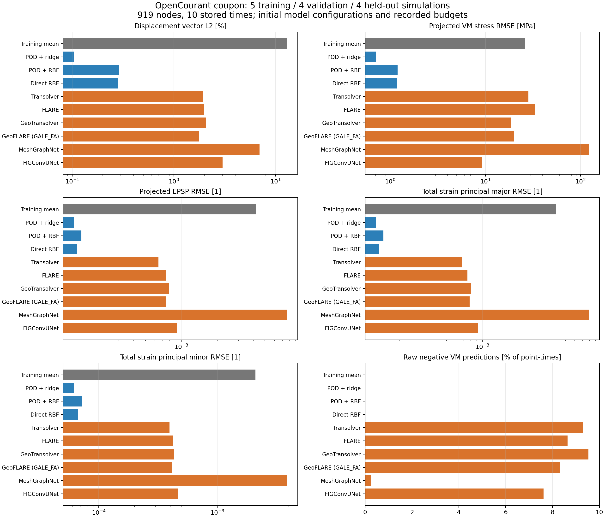

# 구조해석 다중 물리량 실행 검증

2026-10-15에 실제 생성·학습·추론한 증거를 모은 후속 연구 기록이다. **구조역학만** 다루며 유체 예제는 포함하지 않는다. 진행 중인 실험을 완료로 세지 않는다. 아래 수치의 원본은 개별 실행의 JSON·로그·독립 검산이다.

## 실제 정답 확보

| 구조 예제 | 실제 정답과 규모 | 응력·변형률의 의미 |
|---|---|---|
| 공개 범퍼 충돌 | 131해석, 1,441 ANIM 원본, 전체 변형체 13,675절점, 공통 11시점. 학습112/내부 검증12/평가7 | shell local 응력에서 계산한 upper/lower 면내 VM, upper/lower 등가소성변형률(EPSP). 면적 투영 nodal scalar와 원 cell tensor·상태를 별도 보존 |
| OpenCourant DP600 인장 시편 | 직접 생성한 13해석, shell808개·학습 절점919개·10시점. 학습5/검증4/평가4 | native VM, EPSP, native total-strain tensor의 면내 주값 major/minor. 총변형률을 변위 미분으로 대체하지 않음 |
| OpenCourant 휴대폰 초기 충격 | 실제 9조건·전체 출력 corner76,065절점·17부품, 학습5/검증2/평가2. 별도 중심 조건100µs도 정상 완주 | native solid stress·total strain·EPSP 및 GPS nodal stress. 학습 구간20µs와 추가 FEM100µs는 전체 낙하·최대 응답 완료가 아님 |
| 공개 DeformingPlate | 실제 400시점 궤적 다운로드·학습·자기회귀 실행 | 원본 nodal VM 응력. 원 COMSOL strain 출력은 없으며, 좌표에서 계산한 Green–Lagrange strain은 별도 유도 기준값 |

공개 curated 범퍼의 변위만으로 응력 학습이 됐다고 주장하지 않았다. RAW ANIM 3.799GB를 추가 확보하고, hash·형상·ID·실제 시점·물리량·112/12/7 분할을 검증한 2.921GB 라벨 캐시를 동결했다. 전체 cache 작성자의 전수 hash 검증과 독립 검토자의 메타데이터 전수·원 binary 표본 검산은 별개다. [범퍼 정답 추출](fem-labels/README.md), [시편 정답 생성](benchmarks/structural_coupon/README.md)

범퍼 Run224는 total-strain 출력 카드를 추가하여 OpenCourant FEM을 실제 재실행했다. Starter 10.72초 + Engine 502.69초이며, 출력 추가 전후 11시점의 변위·응력·EPSP 차이는 0이었다. 이 total-strain 정답은 **한 조건**이며 131조건의 total-strain 일반화 데이터로 취급하지 않는다.

## 확인된 예측 결과

인장 시편에서 세 회귀/축약 모델과 PhysicsNeMo 여섯 설정이 실제 fit·학습·별도 평가·체크포인트 재추론을 마쳤다. 여섯 설정은 다섯 backbone 계열이며, GeoFLARE는 GeoTransolver의 `GALE_FA` attention 변형이다. 단위·절점·시간·분할·train-only 통계를 맞춘 결과이며, 전부 고정 형상과 두 가지 조건 변수의 보간 시험이다.

| 시편, 평가4조건 | 변위 벡터 상대 L2 | VM 응력 상대 L2 / RMSE | EPSP 상대 L2 | 총변형률 주값 major / minor 상대 L2 |
|---|---:|---:|---:|---:|
| POD + quadratic ridge | 0.10381% | 0.13648% / 0.70462MPa | 0.40997% | 0.38762% / 0.38841% |
| Transolver, 1,000epoch | 1.91108% | 5.49081% / 28.3485MPa | 2.09416% | 2.05924% / 2.48257% |
| FLARE, 1,000epoch | 1.98289% | 6.47775% / 33.4440MPa | 2.40148% | 2.28893% / 2.68276% |
| GeoTransolver GALE, 1,000epoch | 2.05914% | 3.59524% / 18.5619MPa | 2.56986% | 2.46994% / 2.70034% |
| GeoTransolver GALE_FA, 1,000epoch | 1.76022% | 3.89231% / 20.0956MPa | 2.42083% | 2.39051% / 2.62752% |
| MeshGraphNet, 325epoch / best225 | 6.94849% | 23.7175% / 122.4514MPa | 24.9543% | 24.1273% / 24.2624% |
| FIGConvUNet, 465epoch / best365 | 3.00770% | 1.79232% / 9.2536MPa | 2.97786% | 2.80558% / 2.94235% |

최소100epoch·검증 patience100·최대1,000epoch을 공통으로 적용했고, MGN과 FIG는 내부 검증 정체로 조기 종료했다. 나머지 설정은 예산 상한 또는 그 근처가 최선이므로 수렴을 입증하지 못했다. 단일 seed·작은 개별 구조·서로 다른 파라미터 수의 결과이며 알고리즘의 보편적 우열이 아니다. 여섯 설정의 학습 시간은77.08–375.78초였다. 새 프로세스 재추론은 다섯 설정에서 차이0, MGN에서 최대0.000183105MPa(정규화 차이1.614e-6, 사전 허용치1e-5 이내)였다. [원 비교표·실행 hash](benchmarks/structural_coupon/static-six-model-comparison.json)

POD는 내부 검증으로 rank2를 골랐으며 training의 중심화 응답 분산 99.99374%를 설명했다. 형상이 고정되고 조건이 두 개뿐인 응답은 저차원 회귀에 유리하다. 이 낮은 오차를 임의의 가전제품·새 메시·접촉·파손 일반화로 해석하지 않는다. [회귀/축약 실행](benchmarks/rom/coupon13/metrics.json)

Transolver는 최선 epoch가 예산 상한 1,000과 같아 수렴을 입증하지 못했다. 변위 전체 L2는 1.91%지만 작은 횡변위 y의 상대 오차는 55.17%였다. 원래 평면 문제의 u_z는 약 1e-13mm인데 예측 z RMSE는 0.002512mm였다. 예측 응력 36,760개 중 3,417개가 음수(최소 -57.88MPa), EPSP는 6,753개가 음수였다. 전역 평균 오차만으로 물리적으로 타당한 모델이라고 판정하지 않는다. POD의 EPSP 음수는 약 1e-9 수준이며 크기를 함께 구분한다. 원 예측을 clipping하지 않았다.

FIG는 이번 신경망 중 응력 오차가 가장 작았지만 EPSP 음수6,787개, 시간에 따른 EPSP 감소7,962개, major/minor 순서 위반2,477개가 있었다. 면외 z 오차도 RMSE0.01543mm·최대0.09070mm였다. 응력 평균 오차가 작다는 사실만으로 물리 제약까지 통과했다고 판정하지 않는다. [물리량별 FEM/예측/오차 그림](benchmarks/structural_coupon/models/figconvunet/)

범퍼의 다중 물리량 POD+RBF도 실제 학습·내부 검증 선택·평가를 마쳤다. 변위 L2는 3.0320%지만 VM upper/lower L2는 15.059%/15.572%(RMSE 43.357/45.201MPa), EPSP는 51.849%/55.022%였다. EPSP 예측의 약 22%가 음수였다. **변위가 잘 맞는다는 이유로 소성변형·파손 위험도 맞는다고 판단할 수 없다.** 이 사례의 strain은 EPSP이며 total strain과 다르다.

DeformingPlate의 공식 HybridMeshGraphNet 축소 구조를 두 설정으로 실제 학습했다. 각각 12epoch·1,920업데이트이며 399단계 자기회귀를 평가했다. noise 제거와 loss 정규화 변경을 묶은 설정은 drift를 줄였지만 내부 검증 응력을 악화했고, 두 설정 모두 정확도 실패였다. 원 COMSOL strain이 없는 이 예제의 유도 strain 비교를 native FEM strain 검증이라고 부르지 않는다. [판 실행 기록](benchmarks/deforming_plate/README.md)

## 휴대폰 전체 조립체의 실제 예측과 범위

공개 deck으로 새로 생성한 OpenCourant9조건의 전체 출력 corner76,065절점에서 POD+RBF, POD+ridge, 직접 RBF를 실제 fit·내부 검증 선택·평가·새 프로세스 재추론했다. 원257,099절점 중181,034개 TETRA10 midside는 이 출력 support에서 제외한다. 17부품의 실제 solid 인접 graph는561,184방향간선·17연결 성분이다. FEM의14개 tied/contact 및 wall을 가로지르는 간선을 학습 graph에 추가한 것은 아니다. [FEM·데이터 정의](benchmarks/drop_test/PHONE-FEM-AND-DATASET.md), [전체 예측](benchmarks/rom/phone9-full/metrics.json)

| 전체 corner, 평가2조건 | 변위 L2 | 병진 제거 형상 변위 L2 | GPS 응력 VM L2 | 총변형률 Frobenius L2 | EPSP L2 |
|---|---:|---:|---:|---:|---:|
| POD + RBF | 0.02620% | 1.356% | 2.61635% | 2.11085% | 30.9711% |
| POD + ridge | 0.02847% | 1.474% | 2.24952% | 2.13582% | 25.0761% |

POD rank4는 학습5조건의 양수 중심화 mode4개 전부를 사용하므로 full POD+RBF와 직접 RBF 결과는 수치적으로 거의 같다. 이를 별개의 성능 우위로 세지 않는다. 변위 기준 norm²의99.9627%가 평균 병진이며, 작은 전체 변위 L2로 국부 변형을 대신 평가하지 않는다. 평가2조건 EPSP는 총1,521,300개 절점×시점 중27개만 비영이고 첫 조건의 정답 EPSP는 전부0이다. 정답 norm0인 조건의 EPSP 상대 오차는 undefined로 두고 절대 오차·비영 support를 따로 기록했다. 세 predictor는 새 프로세스 재추론 차이0을 확인했다.

학습 GPS_VM은 원6성분 nodal GPS 응력에서 계산한 scalar이며 native cell/IP VM와 다르다. 중심20µs의 학습 GPS_VM peak26.1854MPa와 native cellVM peak51.3603MPa, projected EPSP peak0.0005591과 native cell EPSP0.0027207을 구분한다. 투영 label이 잘 맞아도 원 cell/IP hotspot·제품 파손 위험이 그대로 검증된 것은 아니다. Total strain은 valid IP global tensor를 초기 선형 corner 체적으로 투영한 뒤 Frobenius를 구한 scalar다. 원 tensor는 별도 보존했고, 공식 solver source의 shear HALF 및 global 회전을 확인했다.

별도100µs 기준 FEM도 exit0으로 정상 완료했다. 20→100µs 추가8,079cycle·721.59초·sampled peakRSS388.82MiB이며, 시작 경계의 원 응답과 bitwise동일성을 확인했다. 실제 마지막100.008663µs의 native VM73.505MPa·EPSP0.0625744·소성solid240개로20µs보다 반응이 계속 커졌다. 마지막 시점이 여전히 최대이고 양의 반발도 없어 full-drop peak/rebound 완료로 판정하지 않는다. 20µs AI를100µs에 적용한 결과도 아니다. [추가 FEM 증거](benchmarks/drop_test/100us/)

## 실행 범위와 읽는 기준

공식 예제 source pin은 `11685edb3ec1fb6f25665e96cf7a8c4d11a23f16`(current source2.3.0a0)이고, 실제 학습 backbone은 설치된 배포 PhysicsNeMo2.2.2다. 생성자 차이·삭제한 미지원 옵션·실제 source hash를 실행별 보존했다. [공식 실행 행렬](source-matrix/README.md)은 현행 20개 설정 조합과 archived Sym 3개를 분리한다. 20개 모델을 학습했다는 뜻이 아니다. 소스 확인, 설치, GPU 역전파, 실제 학습, 별도 FEM 평가, 독립 수치 검산, 물리 실험 검증을 각각 구분한다. [공통 실험 규약](experiment-contract.json)

실제 실행 장소는 사용자 PC의 RTX3060 Laptop 6GiB다. Codex Cloud는 별도 컨테이너에서 CPU·RAM·네트워크·GPU 장치를 검사했지만 NVIDIA GPU가 노출되지 않았다. 이 로컬 GPU 결과를 Cloud GPU 실행으로 기록하지 않는다. 유료 GPU나 추가 결제는 사용하지 않았다.

PhysicsNeMo2.2.2와 Torch2.10.0+cu126, 호환 공식 torch_scatter wheel, PyG를 새 전용 환경에 설치했다. 실제 Transolver·FLARE·GeoTransolver·GeoFLARE 방식(GALE_FA)·MeshGraphNet·FIGConvUNet의 여섯 설정은 13,675절점에서 CUDA 역전파와 가중치 갱신을 통과했다. 시편 여섯 설정의 학습·평가는 위 표로 구분하며, 휴대폰·범퍼의 다물리량 신경망 학습은 별도로 진행한다. 기존 실행 환경과 앞선 변위 전용 연구는 보존했다.

공식 Q1 `Elasticity2DSolver`도 CPU에서 실제 실행해 독립 해·힘·모멘트·에너지 등13개 검사를 통과했다. 변위 상대 L2는2.324e-10, 두 solve 합계0.592초, import 포함10.898초, 최대 메모리196.68MiB였다. 이는 수치 FEM baseline이며 구조 FNO·DDM 전체 실행이나 AI 학습으로 세지 않는다. [실행·독립 검산](benchmarks/elasticity_numerical/execution-report.md)

## 보존과 재현

원본 URL·commit·license·입력/결과 hash, solver/framework 버전, 분할, 정규화, 실제 실행 소스, 실패 로그, 시간·메모리, 물리 단위 오차와 그림을 기록한다. 로컬에는 체크포인트와 예측·FEM 원 배열도 보존한다. 이번 후속 공개 묶음은 원본 deck·대용량 데이터·타사 실행 파일·모델 가중치를 제외하고 재획득/생성 코드와 증거를 제공한다. 공개 경로를 지운 사본은 `publication-byte-manifest.json`에 원본/공개본 hash를 모두 기록해 구별한다.

[재현 패키지](reproduction/README.md)는169개 소스·설정과22개 실행 버전 profile을 보존한다. 새 work 경로에115개 파일의 실제 복원·기록 버전 복원·덮어쓰기 거부를 검증했으며, 신규 환경 설치부터 전체 학습까지의 재현과 구분한다. [자동 비교 CSV](comparison-fields.csv)는 완료된 공통 field 지표만 모으고, 분할·물리량·시점·정규화가 다른 실험을 한 순위로 섞지 않는다. 새 프로세스 재추론을 추가 학습으로 중복 집계하지 않는다.

공개 FEM deck의 CC BY-NC4.0, solver AGPL, NVIDIA 코드 Apache-2.0, 라이선스 미확인 데이터는 서로 다른 권리 범위다. 회사 모델·데이터는 사용하지 않았다. 개인 공개 연구의 재현 경로를 회사 상용 데이터 사용 허가로 해석하지 않는다.
