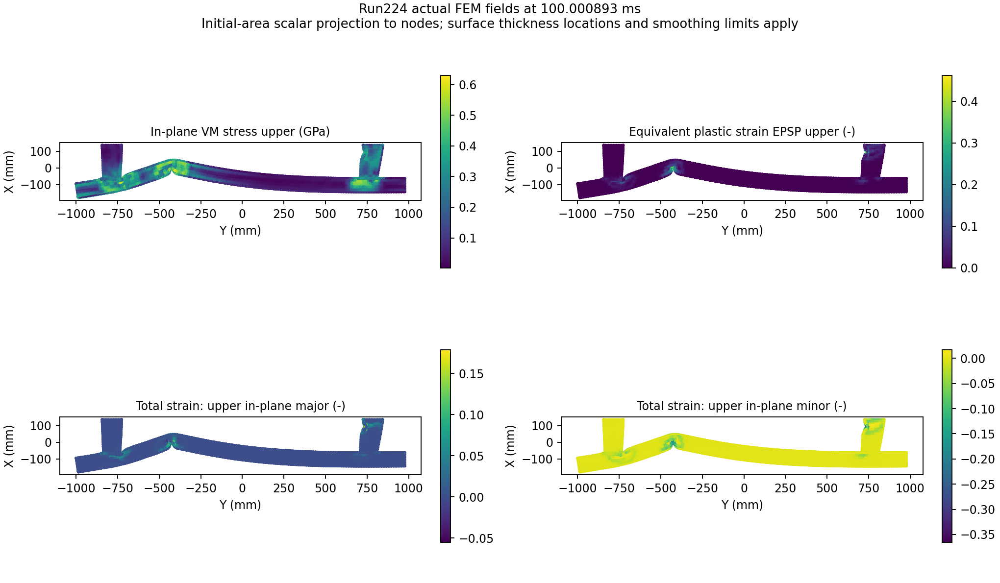

# 범퍼 응력·변형률 FEM 라벨의 실제 확보·검증

공개 원본 ANIM을 직접 읽어 **131조건의 변위·shell 응력·등가소성변형률(EPSP) 라벨 구축과 hash 동결을 완료했다.** 원본에 없는 **총변형률은 동일 Run224에 출력 카드만 추가해 OpenCourant로 실제 생성했다.** 총변형률을 변위 미분값이나 EPSP로 대체하지 않았다. 원본 131조건 캐시의 최종 완료 증거는 `dataset-build-summary.json` 및 `work/expanded-fem-labels/cache/READY.json`이다. 이 폴더는 FEM 정답 구축 결과이며 AI 학습·정확도는 별도 모델 결과에서 평가한다.

전체 다운로드는 1,593.415 s, 최종 순차 writer는 다운로드 대기·기존 검증 캐시 재사용을 포함해 1,031.418 s, 최종 전체 freeze 검사는 36.373 s였다. 이 단계들은 병행되었으므로 합산한 시간을 전체 경과시간으로 제시하지 않는다. 131조건의 14개 NPY씩 **2,920,925,078 B**를 검증했고, 모든 배열 유한성·고정 shape·같은 node IDs/초기좌표·112/12/7 분할·원본 1,441개 LFS 해시 대조를 통과했다. 전체 source ANIM 대 curated 변위 component RMSE 최대는 0.000009001 mm, 실제/명목 시각 차이는 최대 0.000984192 ms였다. extractor 관측 최대 working set은 132,673,536 B다. status 0 shell-frame entry는 전체 23개이며 투영 정책과 함께 보존했다.

최종 READY SHA256은 `b0c6bdb62b677d123c5020f941e7498273909ae8b7c773f237c8477bef909694`다. 원캐시는 이후 쓰기를 금지한 상태로 모델 담당에 인계했다.

## 실제 FEM 추가 실행

입력·데이터 revision은 `78f1302fba4d75926c6fdd22d01d5133efc14742`, OpenCourant 실행 commit은 `cb760c206e346eff12161a2268b134ef9d48a4ef`다. 원 Starter는 byte-identical로 유지했고 Engine 끝에 `/ANIM/SHELL/TENS/STRAIN/ALL`, `/ANIM/SHELL/VONM`만 추가했다. 재료·접촉·메시·초기속도·경계조건·시간간격·종료시각을 바꾸지 않았다. 현재 solver는 실제 post-processing strain flag=1을 사용하여 Istrain property를 고칠 필요가 없었다.

| 측정 | 실제 결과 |
|---|---:|
| Starter / engine | 10.7201 s / 502.6909 s |
| 프로세스 관측 최대 working set | 220,459,008 B / 93,966,336 B |
| 병렬 설정 | CPU 2 threads, 1 domain, extended single precision |
| 종료 | 양쪽 exit 0, NORMAL TERMINATION, 100,001 cycles |
| 마지막 에너지·질량 | IE 6,037 J, KE 215.2 J, energy error −0.4%, mass-error fraction 0.0002315, added mass 0.1196 kg |
| 총변형률 라벨 | 실제 FEM local in-plane tensor, 11시점 × 13,626 shell × 7두께위치 × 3성분 |
| 총변형률 범위 | −0.4889913…0.3209673, 무차원, 초기값 0 |

기존 **같은 OpenCourant/같은 물리 입력** 실행과 11프레임을 직접 비교했다. 실제 시각, NODE_ID·요소ID·연결은 일치하며 변위·응력 7위치·EPSP 7위치의 최대 차이가 모두 **0**이다. 이는 출력 추가가 기존 실행 응답을 보존했다는 실제 검증이다. 원본 공개 OpenRadioss와 새 OpenCourant의 버전·수치 차이 비교는 별도다. `total-strain-validation.json`과 독립 감사 결과에 증거를 기록했다.

최종 ANIM의 이진 실제 시각은 100.000892639 ms다. 기존 converter의 여섯 유효숫자 ASCII 표시는 100.001 ms다. 명목 100 ms 프레임과 대응시키며 시간 보간은 하지 않았다. 실행 시간은 이 1조건의 관측이며 다른 조건·하드웨어의 실행시간이나 AI의 전체 처리 속도 배수로 일반화하지 않는다.



## 공통 131조건 라벨과 지원 위치

HF RAW 전체 15,272,439,272 B 대신 A001…A011만 선택했다. **131조건 × 11프레임 = 1,441개, 3,799,370,861 B**다. 원본 Run194·Run203의 A012는 공통 0…100 ms 계약에서 제외했으며 실제 시각과 명목 시각의 대응도 최종 freeze 검사한다. 다운로드는 2 workers, 스트리밍 저장·재개·파일별 LFS SHA256 검증을 사용한다.

원본 소스의 13,832 노드를 그대로 curated 순서라고 가정하지 않았다. 초기 RAD 좌표와 curated 두께 양수 노드를 일대일 대응하고 실제 ANIM NODE_ID로 매 프레임 정렬했다. Run224에서 초기 거리 최대 0.00003305 mm, 두 번째 후보 최소 1.93966 mm다. 모든 실제 shell은 요소ID+partID·3/4 corner와 **corner 순서**를 확인했다. 13,675개 양의 두께 노드와 13,626개 실제 shell만 학습 지원에 사용한다.

캐시는 `work/expanded-fem-labels/cache/RunXXX`에 둔다. 원본 셀 텐서와 절점으로 투영한 스칼라를 함께 보존한다.

| 파일 | shape / 의미 |
|---|---|
| `nodal_targets.npy` | float32 `[13675,11,7]`: 변위 XYZ(mm), inplane_vm upper/lower(GPa), EPSP upper/lower(무차원) |
| `shell_stress_local_inplane.npy` | `[11,13626,7,3]`: 실제 FEM local xx,yy,xy 응력(GPa) |
| `shell_epsp.npy` | `[11,13626,7]`: 실제 등가누적소성변형률, 총변형률과 구분 |
| `shell_animation_status.npy` | uint8 `[11,13626]`: 실제 ANIM/VTK EROSION_STATUS 보존 |
| 노드·메시·시각 파일 | `node_id`, `coords`, `thickness`, `curated_node_indices`, 실제 shell 요소ID·partID·nodeID·초기면적, 실제/명목 시각 |

7위치는 upper, lower, layer 1…5이며 독립 적분점이 7개라는 뜻이 아니다. 응력 upper/lower는 최외곽 적분점, 총변형률 upper/lower는 외표면 외삽값이다. Shell tensor는 요소 local 좌표의 in-plane xx,yy,xy이며 converter의 3×3 zero padding을 full 3D tensor로 해석하지 않았다. Strain xy는 tensor shear εxy이고 engineering shear γxy의 1/2이다. 총변형률의 정확한 finite-strain measure는 확정하지 않았으므로 Hencky·Green–Lagrange 등으로 임의 명명하지 않는다.

절점 inplane_vm은 실제 셀 응력의 `sqrt(xx²−xx·yy+yy²+3xy²)`에서 계산한 면내 불변량이다. 셀 scalar에 초기 기하 면적을 unique corner 수로 나눈 가중치를 주어 인접 shell 평균을 구했다. 서로 다른 local tensor 성분을 절점 평균하지 않았다. 이 scalar 투영은 재료·part 경계와 hotspot을 평활화한다. 파손위험·최대응력 검증을 위해서는 canonical 셀 라벨을 별도로 평가해야 한다.

실제 Run100에서 마지막 1개 shell의 status가 0으로 바뀌고 응력은 0이지만 EPSP 이력은 남았다. 이번 공통 투영은 **고정 초기 topology의 모든 실제 shell을 포함**하며 status 0도 제외하지 않는다. 상태와 시점별 개수를 기록했다. 삭제된 요소의 EPSP 이력 예측을 현재 유효한 파손·잔존강도 예측으로 해석하지 않는다.

## 총변형률 1조건은 별도 캐시

`work/expanded-fem-labels/new-total-strain-cache/Run224`는 새 FEM 실행이며 원본 131조건 family와 섞지 않는다. 위 파일들에 더해 실제 local 총변형률 `shell_total_strain_local_inplane.npy [11,13626,7,3]`, 실제 solver 기본 집계 `shell_solver_von_mises.npy [11,13626]`, 면내 총변형률의 major/minor 고유값 upper/lower를 scalar 투영한 `nodal_total_strain_principal.npy [13675,11,4]`가 있다. 후자는 full 3D principal strain이 아니다. 이 1조건에서의 공간·시간 재구성을 조건 일반화 성능으로 부르지 않는다.

## 재현 절차

Python 환경에는 NumPy, SciPy, VTK, psutil이 필요하고 그림에는 Matplotlib, curated-data downloader에는 requests가 필요하다. Solver는 이 저장소 `outputs/fem-experiment/download-fem.ps1`, 원 Run224 deck은 `outputs/bumper-fem-rerun/download-bumper.ps1`로 pin·hash를 유지해 받을 수 있다. 전체 조건의 실제 NODE_ID/요소 연결 대응에도 이 RAD 원본이 필요하다. 기록된 실행·학습 결과를 덮어쓰지 않도록 새 `work/` 폴더를 사용한다.

```powershell
python outputs/experiment/download_from_manifest.py --destination work/physicsnemo-experiment
./outputs/bumper-fem-rerun/download-bumper.ps1
python outputs/expanded-research/fem-labels/bulk-anim-cache.py download --manifest outputs/expanded-research/fem-labels/selected-anim-manifest.json --source-root work/reproduced-fem-source --workers 2
python outputs/expanded-research/fem-labels/extract-ready-caches.py --source-root work/reproduced-fem-source --cache-root work/reproduced-fem-labels
# 바로 앞 추출 프로세스의 실제 exit code 0을 확인한 다음 실행한다.
python outputs/expanded-research/fem-labels/freeze-label-cache.py --cache-root work/reproduced-fem-labels --selected-manifest outputs/expanded-research/fem-labels/selected-anim-manifest.json --report-dir work/reproduced-label-reports --writer-exit-code 0
```

원본 데이터는 `.npy` 단위 mmap으로 한 조건씩 사용한다. 공식 converter와 대조한 직접 이진 ANIM reader는 원 float32 정밀도를 보존한다. Run100 11프레임은 직접 추출 2.20 s, 기존 converter+VTK 경로 20.79 s로 관측했다. 두 방법은 ASCII 반올림 오차 범위 안에서 모든 field·ID·연결이 일치했다. 직접 읽기 자체와 전체 추출·해시 시간을 혼용하지 않는다.

추출기는 case manifest를 먼저 building으로 바꾸고 별도 staging에서 모든 배열을 완성·닫은 뒤 NPY를 atomic replace하며 complete manifest를 마지막에 commit한다. **전체 writer의 실제 exit 0과 최종 READY/hash 동결 이전에는 모델 학습을 시작하지 않는다.** freeze는 131조건의 필수 shape·모든 파일 해시·유한성·공통 노드·실제 시각·고정 source LFS 해시·112/12/7 분할을 확인한다.

총변형률 FEM을 새 폴더에서 반복하려면:

```powershell
./outputs/bumper-fem-rerun/download-bumper.ps1
python outputs/expanded-research/fem-labels/prepare-total-strain.py --run-dir work/reproduced-total-strain --report-dir work/reproduced-total-strain-reports
./outputs/expanded-research/fem-labels/run-total-strain.ps1 -RunDirectory work/reproduced-total-strain -ReportDirectory work/reproduced-total-strain-reports
python outputs/expanded-research/fem-labels/extract-anim-fields.py --anim-dir work/reproduced-total-strain --run-name Run224 --output-dir work/reproduced-total-strain-labels --include-total-strain --provenance new_output_only_OpenCourant_Run224
```

이 실행은 추가 GPU·유료 자원을 쓰지 않은 Windows CPU 실행이다. Starter/engine 각각 1,200 s·600 MB 상한과 2 threads를 유지했다. 1조건 약 513 s를 단순 선형 환산하면 131조건 재생성은 약 18.7시간이나 이는 **추정**이며 실제 DOE 수행·비용 견적이 아니다. 원 응력/EPSP 라벨은 재해석 없이 공개 ANIM에서 확보하므로 총변형률 대량 DOE와 구분한다.

## 출처·배포

원 모델은 Copyright(C)2022 Altair Engineering Inc., [CC BY-NC 4.0](https://creativecommons.org/licenses/by-nc/4.0/) 고지를 가진다. [고정 원본 입력](https://huggingface.co/datasets/AIRBORNEPANDA/BumperBeamCrashExample/blob/78f1302fba4d75926c6fdd22d01d5133efc14742/RAW_DATA/VALIDATION_DATA/Run224/Bumper_Beam_AP_meshed_0000.rad)과 `selected-anim-manifest.json`에서 출처를 보존한다. 생성 결과의 별도 upstream 라이선스는 확인하지 못했으므로 파생 데이터·그림도 원 모델의 출처·비상업 조건을 유지한다. 이를 일괄 MIT 또는 상업 허용 데이터로 재표시하지 않는다.

직접 reader는 [공식 MIT 도구](https://github.com/OpenCourant/Tools/blob/c58c805696f7364f0efe80b5dd1585f70670232e/output_converters/anim_to_vtk/src/anim_to_vtk.cpp)의 format reader에 근거하며 해당 저작권·MIT 고지를 파일 안에 포함한다. Solver는 AGPL-3.0이며 실행기·외부 runtime을 이 폴더에 배포하지 않는다. 공개 폴더에는 코드·수치 보고서·PNG·개인경로/hostname을 가린 로그만 두고 원 RAD·ANIM·VTK·NPY·restart·EXE/DLL/ZIP은 `work/`에 보존한다. 공개 로그의 편집과 원본 hash는 `solver-log-provenance.json`에 기록했다.
