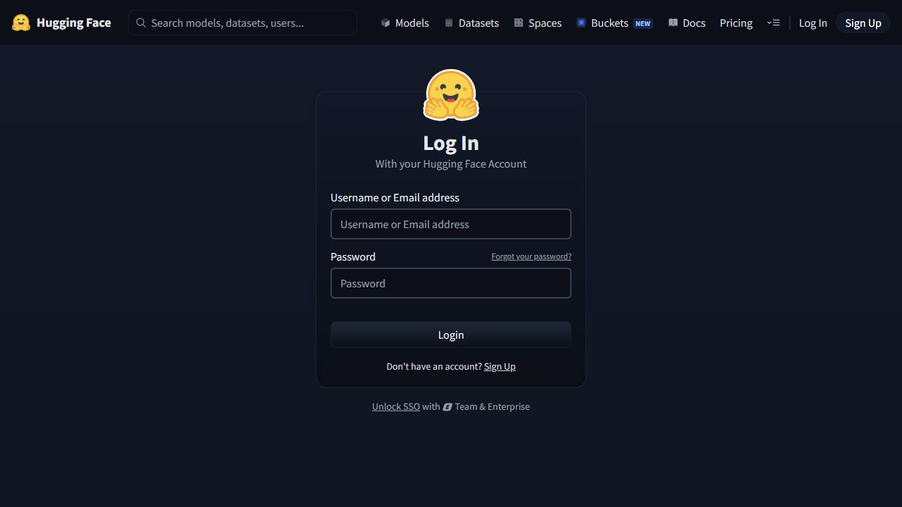

# SHIFT-Crash 접근 확인

2026-10-16에 [SHIFT-Crash 공개 페이지](https://huggingface.co/datasets/luminary-shift/SHIFT-Crash)와 실제 브라우저 화면을 확인했다.

- 공개 페이지는 연락정보 공유에 동의해야 파일에 접근할 수 있다고 표시한다.
- 현재 브라우저는 Hugging Face에 로그인되어 있지 않다. 로그인 버튼을 눌러 데이터 페이지로 돌아오는 로그인 화면까지 열었다.
- **로그인 자격증명을 입력하지 않았고, 데이터 접근 신청이나 동의를 제출하지 않았다.** 따라서 로그인 뒤의 실제 동의 양식·추가 질문·승인 결과는 아직 확인하지 못했다.
- 사용자는 접근 절차와 동의 화면 확인을 승인했다. 사용자의 로그인 뒤 실제 제출 항목을 확인하여 다음 절차를 진행한다.
- 공개 메타데이터 확인과 보호된 파일의 HTTP 401 확인은 [데이터 후보 조사](../complex-public-datasets.md)에 기록했다. 브라우저 로그인은 CLI 인증과 별개다. 토큰·비밀번호를 채팅이나 저장소에 기록하지 않는다.

